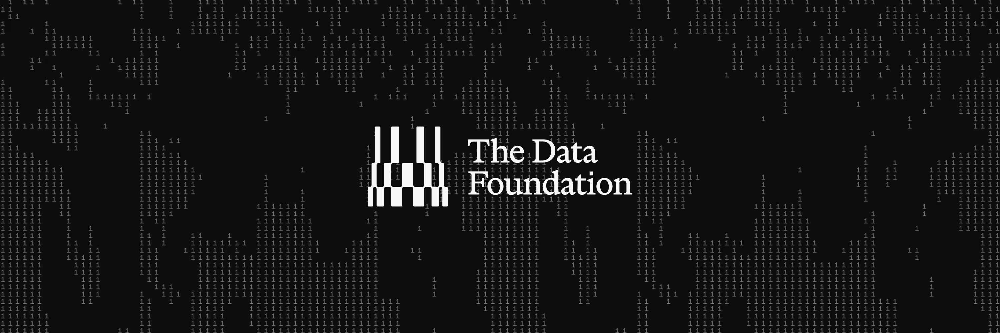

<Callout icon="rocket" color="#16A34A">
  **DATA Network가 Sui 위에서 실행되는 프로토콜로 업그레이드됩니다!**
  이전이 완료되면 독립적인 레이어 1 체인은 종료됩니다.
  [공지 읽기 →](https://x.com/datafdn/status/2109468220273123382)
</Callout>

<Frame>
  
</Frame>

## DATA Foundation {#the-data-foundation}

DATA Foundation은 AI 데이터를 위한 신뢰할 수 있는 원천(source of truth)을 구축하고 있습니다. 핵심 제품인 **Trace**는 권리 처리가 완료된 AI 학습 데이터를 위한 온체인 레지스트리로, 각 데이터가 어디에서 왔는지와 어떤 권리 조건으로 기여되었는지를 기록합니다.

DATA는 [Sui](https://sui.io) 위의 프로토콜이 되어, AI 워크로드를 위해 구축된 스택에 합류합니다: 스토리지를 위한 Walrus, 접근 제어를 위한 Seal, 검증 가능한 연산을 위한 Nautilus.

<Note>
  데이터는 이미지, 음악, 데이터셋, RWA, AI 학습 데이터, 또는 그 사이의 어떤 것도 될 수 있습니다.
</Note>

<CardGroup cols={2}>
  <Card title="Trace" icon="fingerprint" href="/ko/trace/overview">
    검증 가능하고 제공자별로 정규화된 출처 정보: 콘텐츠 해시, 기여자 동의, KYC 신호를 제공하며, 전체 데이터셋에 대한 공개 감사 뷰를 지원합니다.
  </Card>
  <Card title="Sui 위의 DATA" icon="rocket" href="/ko/data-on-sui">
    DATA가 Sui로 이전하는 이유, 달라지는 점과 그대로 유지되는 점을 확인하세요.
  </Card>
</CardGroup>

## 빌드 시작하기 {#start-building}

<CardGroup cols={2}>
  <Card title="Trace 통합 가이드" icon="plug" href="/ko/trace/integration">
    SDK 없이 간단한 REST API로 데이터 출처를 등록하세요.
  </Card>
  <Card title="제공자 되기" icon="discord" href="https://discord.gg/databuilders">
    팀에 문의하여 provider 범위와 API 키를 발급받고 온보딩하세요.
  </Card>
</CardGroup>

<Accordion title="왜 DATA Foundation인가?" icon="face-thinking">
데이터는 AI 시대의 가장 가치 있는 자산이지만, 이를 공유하기 위해 사용하는 시스템들은 데이터를 위해 설계되지 않았습니다. 창작자는 자신의 작품이 온라인에 게시되는 순간 통제력과 크레딧을 잃습니다. AI는 저작권이 있고 동의 없는 데이터로 학습되며, 어떤 데이터가 어디서 왔는지에 대한 이동 가능하고 검증 가능한 기록이 존재하지 않습니다.

Trace는 모든 데이터에 그 출처와 기여 조건에 대한 이동 가능하고 검증 가능한 기록을 부여합니다. Sui에서는 소싱, 스토리지, 접근 제어, 추론이 하나의 스택 위에 존재할 수 있으므로, Trace가 모든 단계를 증명하고 검증할 수 있습니다.

</Accordion>

## 빠른 FAQ {#quick-faqs}

<AccordionGroup>

<Accordion title="토큰은 무엇인가요?">
  $DATA입니다. Sui 위의 DATA 프로토콜 토큰으로 유지되며, 1:1로 이전되고,
  보유자 경제 및 거버넌스 권리는 최소한 현재와 동등하게 유지됩니다.
</Accordion>

<Accordion title="DATA Network는 어떻게 되나요?">
  DATA Network는 Sui에서 네이티브로 실행되는 프로토콜로 업그레이드되며, 독립적인
  레이어 1 체인은 종료됩니다. 업그레이드가 완료될 때까지는 계속 운영됩니다.
  자세한 내용은 [Sui 위의 DATA](/ko/data-on-sui)를, 현재 체인에 대해서는
  [레거시 네트워크](/ko/network/overview) 문서를 참고하세요.
</Accordion>

</AccordionGroup>
